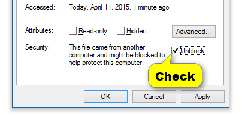

<!-- in VS Code press Ctrl + Shift + V to see a preview-->
# Rhino.Scripting.QrCode

[](https://nuget.org/packages/Rhino.Scripting.QrCode) 
[](https://www.fuget.org/packages/Rhino.Scripting.QrCode)


`Rhino.Scripting.QrCode` is a small Library for generating QR codes as [Rhino](https://www.rhino3d.com/)  Meshes or Hatches via [ZXing.Net](https://github.com/micjahn/ZXing.Net/)
It works in Rhino 6 and 7 with F#, C# and IronPython


## Use in F#

In [Seff.Rhino](https://github.com/goswinr/Seff.Rhino) Editor.   
use via nuget:

```fsharp
#r @"C:\Program Files\Rhino 7\System\RhinoCommon.dll"  // adapt path if needed
#r @"D:\Git\Rhino.Scripting\src\bin\Debug\net472\Rhino.Scripting.dll"

/// set current view to world or layout !!
```   
## Use in Python

1) Get the files `Rhino.Scripting.QrCode.dll` and `zxing.dll` :

    by either downloading the latest release an [unblocking the zip and dll files](https://www.tenforums.com/tutorials/5357-unblock-file-windows-10-a.html) ! 

    

    Or, to avoid this security warning, you could compile the source yourself.

2) Use the dll files

```python
#r @"C:\Program Files\Rhino 7\System\RhinoCommon.dll"  // adapt path if needed
#r @"D:\Git\Rhino.Scripting\src\bin\Debug\net472\Rhino.Scripting.dll"
``` 

## Alternatives

There are alternative QR code tools for Rhino like  [qr-code-generator](https://www.food4rhino.com/en/resource/qr-code-generator) that work with images instead of Rhino geometry.

Also see [discourse.mcneel](https://discourse.mcneel.com/search?q=qr%20code)


